# AstraDrive

**Autonomous driving simulation, hybrid lane perception, and driver-assistance research with BeamNG.tech.**

<p align="center">
  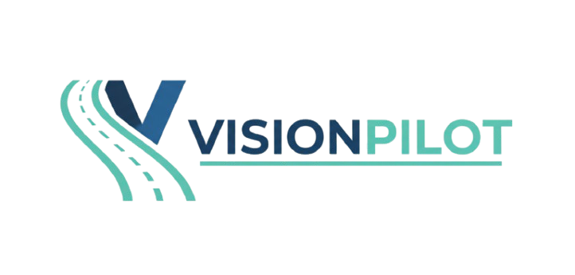
</p>

AstraDrive connects a simulated vehicle to a modular Python perception and control pipeline.
It combines traditional computer vision with UFLDv2 lane inference, YOLO object detection,
traffic sign/light recognition, radar-based assistance, and LiDAR visualization. Lane estimates
feed a PID steering controller while a separate speed-control path manages throttle and braking.

**Status:** research prototype under development. The main simulation runs perception models
locally in one Python process. Docker services and an HTTP aggregator are included as an
experimental alternative, and several planning/fusion modules remain placeholders.

<p align="center" style="margin-bottom:0;">
  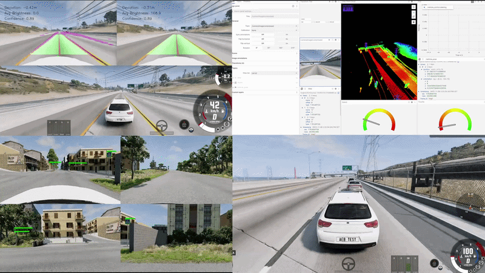
</p>

*Existing simulation recordings and sensor images are retained. Demo footage shows particular
experiments; it is not a benchmark or a guarantee that every demonstrated feature runs together
in the default configuration.*

## Contents

- [Overview](#overview)
- [Features and implementation status](#features-and-implementation-status)
- [Architecture](#architecture)
- [Technology stack](#technology-stack)
- [Getting started](#getting-started)
- [Configuration](#configuration)
- [Sensor suite](#sensor-suite)
- [Demos](#demos)
- [Visualization and telemetry](#visualization-and-telemetry)
- [Experimental service architecture](#experimental-service-architecture)
- [Repository structure](#repository-structure)
- [Training and model artifacts](#training-and-model-artifacts)
- [Development and validation](#development-and-validation)
- [Troubleshooting](#troubleshooting)
- [Limitations and roadmap](#limitations-and-roadmap)
- [Credits and citations](#credits-and-citations)
- [Third-party licenses](#third-party-licenses)

## Overview

The project explores the full loop from simulated sensors to vehicle actuation:

1. **Observe:** launch a BeamNG.tech scenario and poll camera, radar, LiDAR, and vehicle state.
2. **Perceive:** detect objects, signs, lights, and lane boundaries from the front camera.
3. **Estimate:** select the current lane, estimate lane curvature/deviation, and inspect radar returns.
4. **Control:** calculate steering and speed commands, then send them to the simulated vehicle.
5. **Inspect:** view OpenCV overlays and experiment with Foxglove camera, point-cloud, and pose channels.

The focus is modular perception and assisted control in simulation. Detecting a red light or
stop sign does not yet make the vehicle obey it: behavior planning and traffic-rule enforcement
are separate roadmap items.

## Features and implementation status

| Area | Available implementation | Scope / current status |
| --- | --- | --- |
| Lane perception | Brightness-adaptive CV voting, optional UFLDv2 mask, perspective warp, multi-lane fitting, lane selection | Main control input; dependent on lighting, calibration, and model setup |
| Object detection | Ultralytics YOLO wrapper for vehicles, pedestrians, cyclists, and other trained classes | Runs locally in the main camera loop |
| Traffic signs | YOLO localization followed by a TensorFlow/Keras classifier | Detection/classification overlays; no behavior enforcement |
| Traffic lights | Trained YOLO detector/class labels | Detection overlays; no automatic red-light stopping logic |
| Steering | PID controller with a feed-forward term, clipping, and steering-rate limiting | Experimental lane keeping |
| Speed control | PID cruise control and a separate radar/TTC braking branch | Cruise is the default; adaptive behavior is not a complete ACC system |
| Blind-spot detection | Left/right radar filtering and warning logic | Requires enabled rear radars; disabled in the default ETK sensor profile |
| LiDAR | Point-cloud polling, coordinate handling, and visualization support | Active path returns points; boundary/3D-object detection is not enabled |
| GPS / IMU | Sensor creation and basic polling | Dedicated fusion/localization processors remain placeholders |
| Scene segmentation | Mask2Former utilities for saved multi-camera images | Separate offline experiment, outside the driving loop |
| Visualization | OpenCV windows and Foxglove message/channel helpers | Foxglove launcher/publisher wiring needs further work |
| Service inference | Flask wrappers, HTTP aggregator, Docker Compose | Present but bypassed by the main simulation |

## Architecture

### Active simulation pipeline

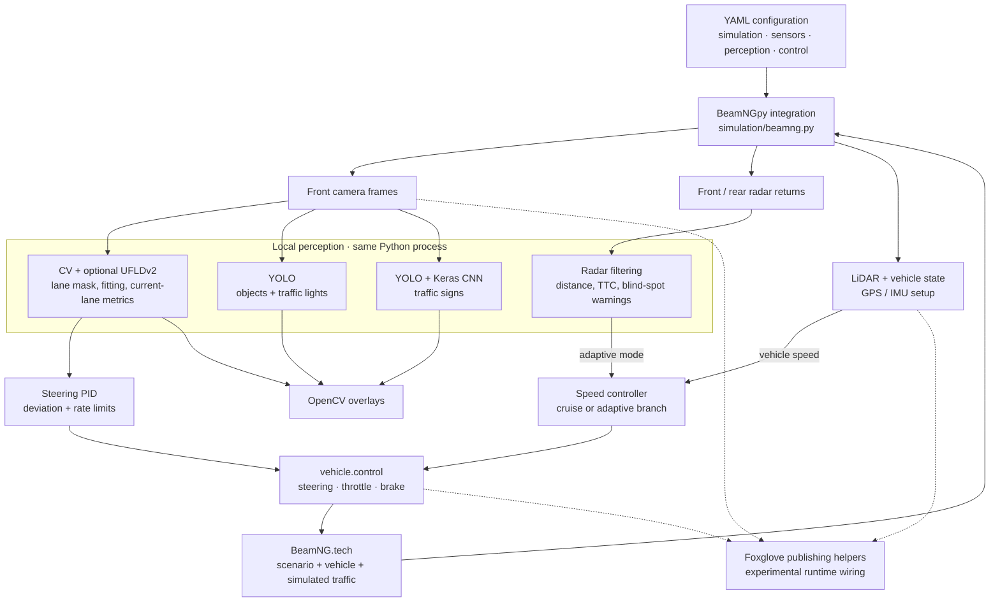

[`simulation/beamng.py`](simulation/beamng.py) owns model loading, simulator setup, sensor polling,
perception calls, control decisions, and display updates. Models are passed to local perception
functions; the main loop does not call the HTTP aggregator or require Redis/Docker.

The configured simulator stepping is deterministic at **60 steps per simulated second**, and
the loop advances **10 steps per iteration**. These are simulation timing settings, not a measured
60 FPS perception rate. Runtime latency depends on hardware, models, sensor load, and visualization.

### Hybrid lane detection

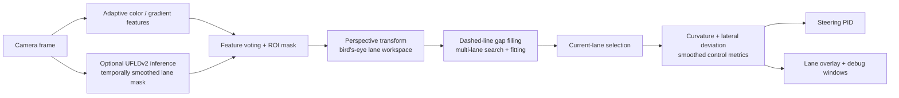

The neural lane mask is one feature in the voting pipeline; the final lane estimate is not
just the raw network output. The loader falls back to CV-only processing when UFLDv2 setup or
inference fails. The current checkout has a UFLD config-path mismatch described below, so
successful model initialization should be checked in the console.

### Control behavior

- Steering uses lane deviation, PID/feed-forward terms, a `[-1, 1]` clamp, and a maximum change per step.
- `cruise` uses a speed PID to maintain the configured target; it does not execute the adaptive AEB branch.
- `adaptive` uses radar-derived TTC to select braking or reduced throttle. The current loop applies
  full braking at TTC ≤ 1 s, partial braking at TTC ≤ 3 s, and reduced throttle for other finite TTC values.
- `none` disables automatic speed calculation, but the loop still sends steering and zero throttle/brake;
  it is not a complete manual-control handoff.

The adaptive branch falls back to cruise when radar processing raises an exception. Sign and
light detections are displayed and do not currently alter these control decisions.

## Technology stack

| Layer | Technologies |
| --- | --- |
| Simulator | BeamNG.tech, BeamNGpy **1.35.1** |
| Vision | Python, OpenCV, NumPy, Pillow, Ultralytics YOLO |
| Learned lane detection | PyTorch, torchvision, bundled UFLDv2 code/configs |
| Classification | TensorFlow **2.19.0**, Keras **3.10.0** |
| Geometry / point clouds | SciPy, Open3D, NumPy |
| Visualization / analysis | Foxglove SDK, Matplotlib, pandas |
| Configuration | YAML and Python path constants |
| Experimental services | Flask, requests, ThreadPoolExecutor, Docker Compose, Redis |
| Offline segmentation | Hugging Face Transformers / Mask2Former; optional dependency |

## Getting started

### 1. Prepare the simulator and Python environment

Install [BeamNG.tech](https://www.beamng.tech/) separately. A desktop capable of running the
simulator and the perception models is required; GPU acceleration is useful for inference.
The repository does not declare a tested Python-version matrix, so use a Python 3 environment
compatible with the pinned packages in [`requirements.txt`](requirements.txt).

From the repository root:

```sh
python -m venv .venv
```

Activate it in **PowerShell**:

```powershell
.\.venv\Scripts\Activate.ps1
```

Or in **Bash**:

```sh
source .venv/bin/activate
```

Then install the Python dependencies:

```sh
python -m pip install --upgrade pip
python -m pip install -r requirements.txt
python -m pip install torch torchvision PyYAML scipy
python -m pip check
```

The extra install makes direct runtime imports explicit: `torch`, `torchvision`, `yaml`, and
`scipy` are used by the code but are not listed directly in the root requirements. Choose
compatible PyTorch/torchvision builds if configuring CUDA acceleration. Dependencies are not
fully locked, so a clean environment may require compatibility adjustments.

The segmentation experiment additionally imports `transformers`; it is not needed by the main
driving loop. The bundled [`ufldv2/requirements.txt`](ufldv2/requirements.txt) contains upstream
training/helper dependencies and is not a complete environment definition for this project.

### 2. Configure the BeamNG installation

Edit [`config/beamng.yaml`](config/beamng.yaml):

```yaml
simulation:
  host: "localhost"
  port: 64256
  home: 'C:\path\to\BeamNG.tech'
  deterministic_fps: 60
```

Use your actual installation directory. The active simulator reads `simulation.home` from
this YAML file. [`config/config.py`](config/config.py) also contains a legacy `BEAMNG_HOME`
constant; it is not the main loop's installation-path source.

### 3. Download the model weights

Supply pretrained weights compatible with the detection/classification modules and place
them in the following locations under `models/`:

```text
models/
├── object_detection/
│   └── object_detection.pt
├── traffic_light/
│   └── traffic_light_detection.pt
├── traffic_sign/
│   ├── traffic_sign_detection.pt
│   └── traffic_sign_classification.h5
└── ufld/
    └── ufld_culane_res18.pth
```

The runtime model directories contain placeholders; weight extensions are excluded by
`.gitignore` for new files. Some historical training checkpoints are tracked elsewhere, but
are not automatically installed into these runtime paths. Supplied weights must match the
expected model architectures and class labels. The four object/sign/light models are loaded before feature
flags are checked, so disabling a module does not remove its startup weight requirement.

UFLDv2 loads lazily on the first lane frame. Its code is bundled; no separate UFLDv2 clone is
needed. However, [`src/perception/lane_detection/main.py`](src/perception/lane_detection/main.py)
currently looks for `ufldv2/configs/ufld_culane_res18.py`, while the included file is
[`ufldv2/configs/culane_res18.py`](ufldv2/configs/culane_res18.py). Align that loader path with the
bundled config before expecting neural lane inference. Otherwise the lane pipeline falls back
to CV-only mode.

### 4. Select a scenario and controller mode

The current `main()` call in [`simulation/beamng.py`](simulation/beamng.py) selects:

```python
sim_setup(
    map_name="italy",
    scenario_type="highway",
    vehicle_name="etk800",
)
```

Change that call to choose `west_coast_usa` or `italy`, `highway` or `city`, and `etk800` or
`q8_andronisk`. Spawn coordinates are defined in [`config/scenarios.yaml`](config/scenarios.yaml).
The Q8 profile needs the matching simulator vehicle content; the default ETK profile avoids
that custom vehicle dependency. Vehicle-specific perspective settings must also match the choice.

In [`config/control.yaml`](config/control.yaml), the defaults are **50 km/h** target speed and
`speed_control_mode: cruise`. Use `adaptive` to exercise the radar braking branch, and check
that the necessary radar sensors are enabled.

### 5. Launch the simulation

With the environment active, run from the repository root.

**Windows PowerShell:**

```powershell
.\scripts\start_simulation.bat
```

**Bash, on a platform with a working BeamNG.tech installation:**

```sh
bash scripts/start_simulation.sh
```

The launchers set the repository/UFLDv2 import paths, attempt to start the Foxglove helper,
and run `simulation/beamng.py`. A shell launcher alone does not establish simulator support
on every operating system. Docker is not required for this local inference path.

Expect model-loading and sensor-initialization messages plus **CV Lane Detection** and
**Object Detections** windows. Press **Q** while an OpenCV window is focused, or interrupt the
terminal, to exit. The simulation's cleanup closes the BeamNG connection and OpenCV windows.

## Configuration

| File | Responsibility |
| --- | --- |
| [`config/beamng.yaml`](config/beamng.yaml) | Simulator host/port/home, vehicle profiles, perception enable/debug flags |
| [`config/sensors.yaml`](config/sensors.yaml) | Sensor positions, orientations, ranges, image sizes, requested update periods, enable flags |
| [`config/control.yaml`](config/control.yaml) | Steering gains/rate limit, target speed, cruise/adaptive mode, speed PID gains |
| [`config/perception.yaml`](config/perception.yaml) | Lane/perception settings, radar filters, AEB/ACC/BSD parameters; some settings are WIP |
| [`config/scenarios.yaml`](config/scenarios.yaml) | Maps, scenario names, spawn positions/yaws |
| [`config/config.py`](config/config.py) | Repository/model path constants and a legacy BeamNG installation constant |

Configuration is only partially centralized. `simulation/beamng.py` still sets simulator
stepping, scenario selection, some detector thresholds, and adaptive braking thresholds in
code. YAML values and comments do not necessarily override those branches. For example,
the YAML comment mentions `manual`, but the main speed-control branch checks `none`.

## Sensor suite

These values describe the **current default `etk800` profile**, not measured end-to-end rates.
The Q8 profile differs. In YAML, requested periods are in seconds: `0.05` means 20 Hz.

| Sensor | Current configuration | Role / status |
| --- | --- | --- |
| Front camera | 1920×1080, 70° vertical FOV, 0.05 s requested update, color enabled, depth disabled | Main camera perception and overlays |
| Roof LiDAR | 80 vertical lines, 360° horizontal coverage, 120 m max distance, 20 Hz frequency | Point clouds and visualization |
| Front radar | 150 m configured range maximum, 128×64 range/azimuth bins, 0.05 s requested update | Adaptive braking metrics |
| Rear left/right radar | Defined but disabled for ETK; enabled in the Q8 profile | Blind-spot warnings when enabled |
| Front/rear GPS | Two configured sensors, 0.05 s physics period | Sensor setup; localization fusion unfinished |
| IMU | 0.01 s physics period | Sensor setup; state estimation unfinished |

<table>
  <tr>
    <td align="center">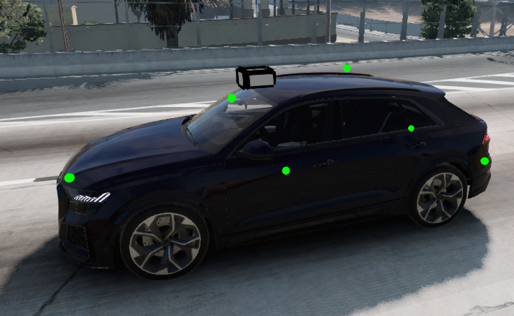</td>
    <td align="center">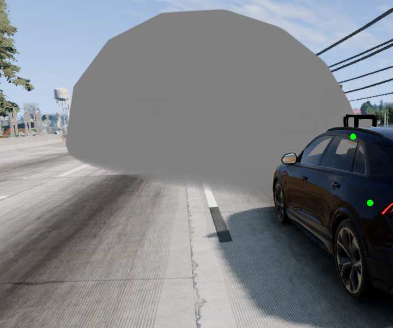</td>
    <td align="center">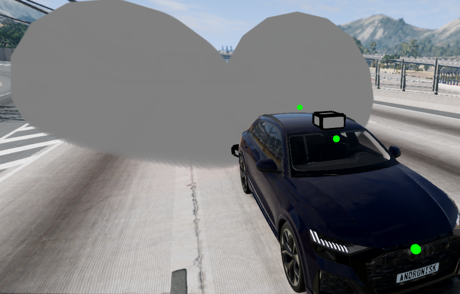</td>
    <td align="center">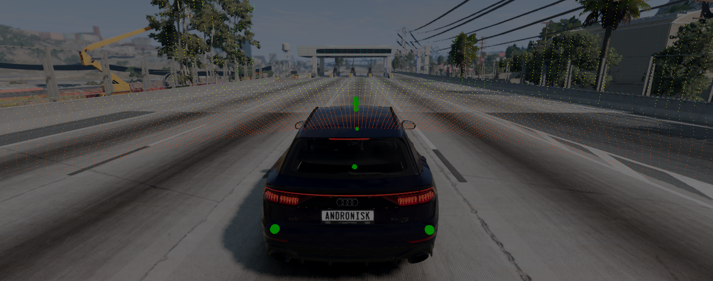</td>
  </tr>
  <tr>
    <td align="center"><em>Sensor Array</em></td>
    <td align="center"><em>Front Radar</em></td>
    <td align="center"><em>Rear Radars</em></td>
    <td align="center"><em>Lidar Visualization</em></td>
  </tr>
</table>

Sensor parameters, rate requests, and range fields differ between profiles and are not a
validated sensor-performance specification. Multi-camera initialization is partly supported,
but the driving loop consumes the primary front camera. The segmentation gallery below is a
separate experiment on saved images.

## Demos

### Multi-Lane Detection Stress Testing
Evaluation of the multi-lane perception pipeline across various environmental edge cases, including high-glare transitions, low-light tunnels, and heavy atmospheric fog:

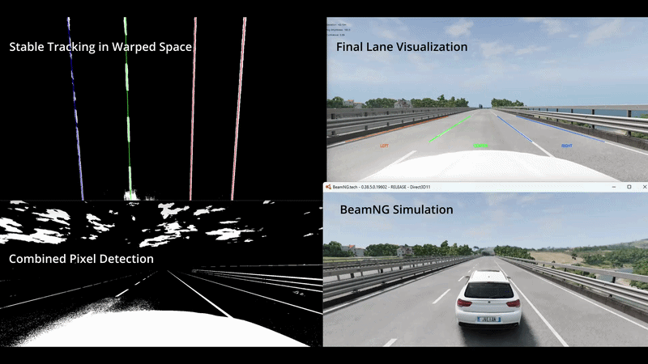

**Extended Demo:** [Watch the full video here](https://youtu.be/IvmJ01pYCSE)

---

### Emergency Braking (AEB)

Watch the Emergency Braking System (AEB) in action with real-time radar filtering and collision avoidance:

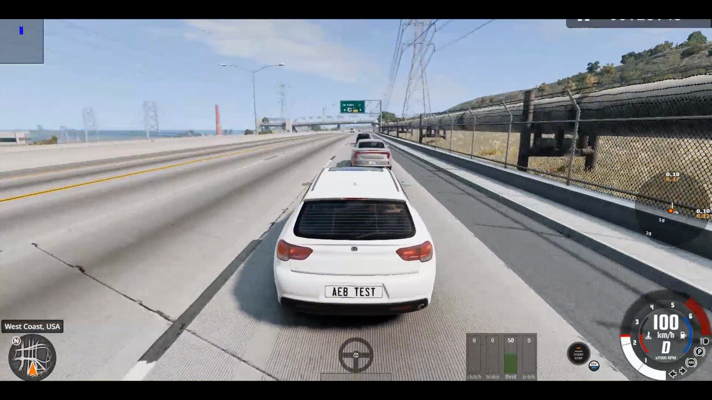

**Extended Demo:** [Watch the full video here](https://www.youtube.com/watch?v=Z8Y2-MpmrRg)

<!--
---

### Blind Spot Detection (BSD)
See the Blind Spot Detection (BSD) system in action using radar data to identify vehicles in the blind spot:

**Extended Demo:** [Watch the full video here](https://www.youtube.com/watch?v=Z8Y2-MpmrRg)

-->

---

### Sign Detection & Classification

This demo shows real-time traffic sign detection and classification:

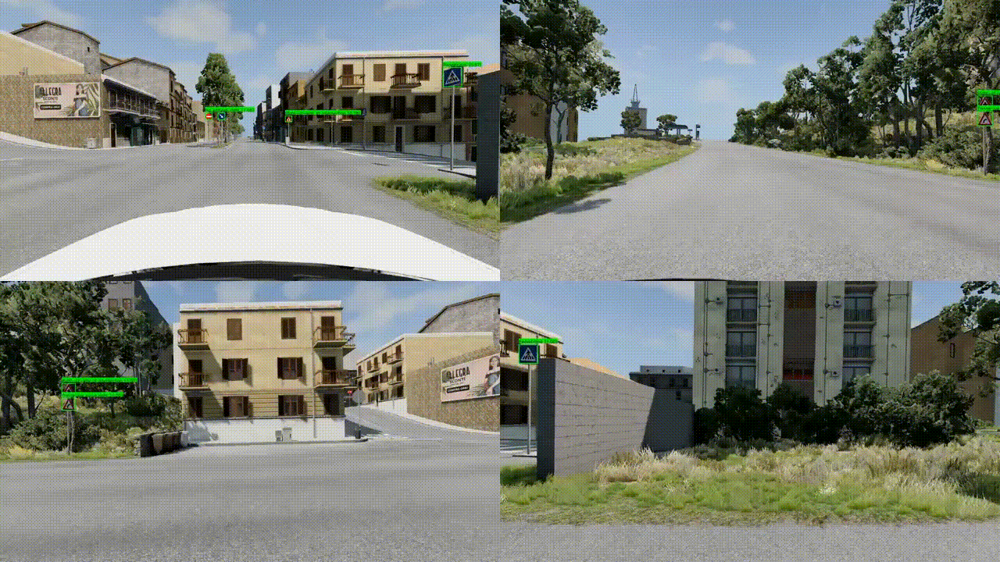

**Extended Demo:** [Watch the full video here](https://youtu.be/ujGkQJ2BqV0)

> The active driving loop uses the primary front camera; this recording does not establish integrated multi-camera perception.

---

### Traffic Light Detection & Classification

This demo shows real-time traffic light detection and classification:

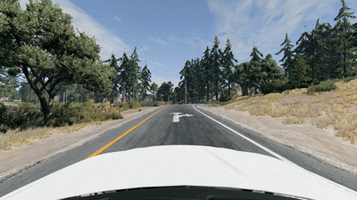

> No extended demo is included yet.

---

### Lane Detection & Keeping (v2)

This recording shows an earlier CV/neural lane-keeping experiment with PID steering and cruise control. The current hybrid lane pipeline is described in the architecture section above:


**Extended Demo:** [Watch the full video here](https://www.youtube.com/watch?v=7eA_XfIkLWQ)

> Note: Very low-light (tunnel) scenarios are not yet supported.

### Previous Lane Detection & Keeping (v1)

Watch the earlier lane-keeping demo:

[Lane Keeping & Multi-Model Detection Demo (v1)](https://youtu.be/f9mHigMKME8)

---

### Ultra-Fast Lane Detection (UFLD)
Watch the UFLD perform real-time lane detection with temporal spline smoothing on highway video.

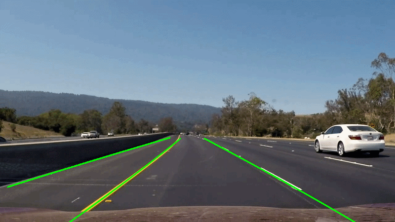

**Extended Demo:** [Watch the full video here](https://youtu.be/Dkj-diRK334)

> Note: Because UFLDv2 operates as an internal feature module in AstraDrive's multi-feature voting pipeline, this standalone demo highlights the underlying model's perception capabilities before its output is merged into the final pixel voting matrix.

---

### Foxglove Visualization

See real-time LiDAR point cloud streaming and autonomous vehicle telemetry in Foxglove Studio:

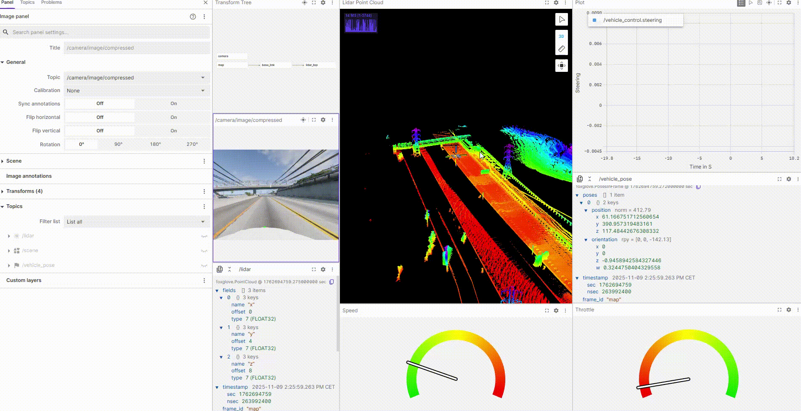

**Extended Demo:** [Watch the full video here](https://www.youtube.com/watch?v=4HJDvL2Q6AY)

---

### Multi Camera Scene Segmentation

A separate scene-segmentation experiment on saved camera images; it is not wired into the live driving loop:

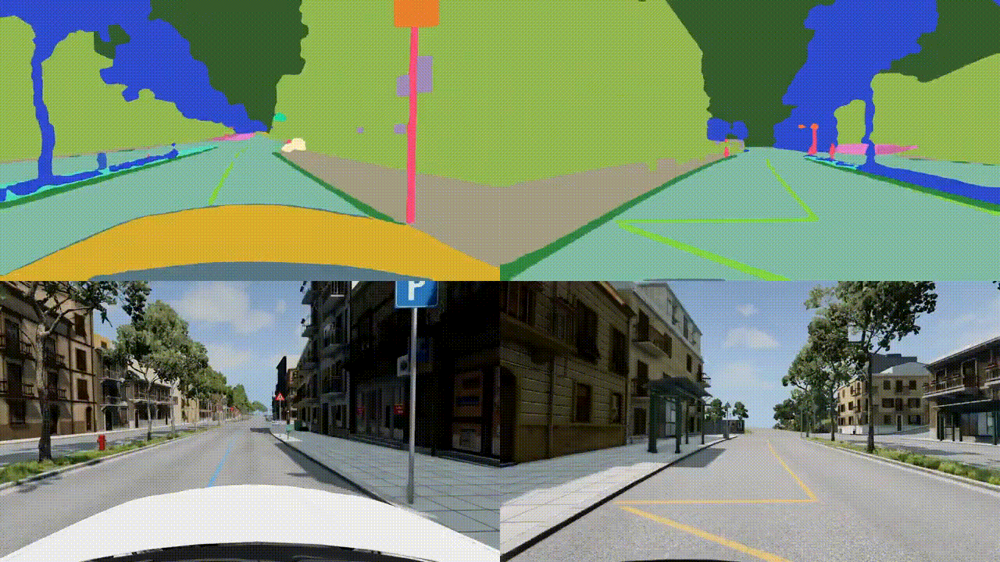

**Extended Demo:** [Watch the full video here](https://youtu.be/4PAqcUKqn6c?si=UHw-mw7iLZKGXvav)

---

> More demo videos and visualizations will be added as features are completed.

## Visualization and telemetry

OpenCV displays the active local lane and detection outputs. Debug switches in
`config/beamng.yaml` enable additional threshold/perspective windows.

[`FoxgloveBridge`](simulation/foxglove_integration/foxglove_bridge.py) defines these channels:

| Topic | Payload |
| --- | --- |
| `/vehicle_control` | Speed, steering, throttle, brake |
| `/vehicle_pose` | Vehicle pose in a frame |
| `/tf` | Frame transforms |
| `/scene` | 3D scene / vehicle model |
| `/lidar` | Point cloud |
| `/camera/image/compressed` | Compressed camera image |
| `/camera/annotations` | 2D detection annotations |
| `/detections_3d` | Scene entities for detection visualization |

The helper advertises `ws://localhost:8765`, with a bridge default bind address of `0.0.0.0`.
Foxglove support is experimental in this checkout: the launcher starts a separate helper process,
while the simulation imports its own `bridge` instance. Those Python objects do not share channel
state. The publishing process must initialize its own server/channels for messages to appear;
starting the helper alone does not guarantee a populated Foxglove session.

[`simulation/drive_log/data.py`](simulation/drive_log/data.py) plots deviation/steering from an
existing CSV. It is a separate analysis utility and does not establish automatic logging of
every simulation run.

## Experimental service architecture

The repo also contains Flask inference services, Dockerfiles, a Compose stack, and an HTTP
aggregator using `ThreadPoolExecutor`. This is an alternative development path; it is not wired
into the active `main()` loop.

| Service | Port | Interface / implementation |
| --- | --- | --- |
| CV lane detection | 4777 | [`cv_lane_detection_service.py`](services/cv_lane_detection_service.py); not included in the current Compose service list |
| Object detection | 5777 | [`object_detection_service.py`](services/object_detection_service.py) |
| Traffic light detection | 6777 | [`traffic_light_detection_service.py`](services/traffic_light_detection_service.py) |
| Sign detection | 7777 | [`sign_detection_service.py`](services/sign_detection_service.py) |
| Sign classification | 8777 | [`sign_classification_service.py`](services/sign_classification_service.py) |
| YOLOP | 9777 | [`yolop_service.py`](services/yolop_service.py); additional model assets needed |
| Redis | 6379 | Included in Compose; not required by the current local simulation |

The Flask wrappers expose `GET /health` and `POST /process`; payload handling is defined in
each service. [`simulation/perception_client.py`](simulation/perception_client.py) and
[`src/communication/`](src/communication/) contain client/aggregation code.

The reference stack is [`docker/docker-compose.yml`](docker/docker-compose.yml). Service
dependencies, aggregator imports, and model paths need review before using it as a runnable
deployment. `scripts/build.sh` and `scripts/start_services.sh` currently resolve a `docker`
directory under `scripts/`, while the tracked directory is at the repository root. They are
not a supported one-command setup for the active driving pipeline.

## Repository structure

```text
astradrive/
├── simulation/
│   ├── beamng.py                 # Active simulator/perception/control loop
│   ├── perception_client.py      # Experimental HTTP aggregator client
│   ├── foxglove_integration/     # Channels, publishing helpers, 3D assets
│   ├── drive_log/                # Existing CSV analysis helper
│   └── q8_config/                # Custom vehicle configuration
├── src/
│   ├── perception/
│   │   ├── lane_detection/       # CV, UFLD, lane selection, metrics, overlays
│   │   ├── object_detection/     # Object detection wrappers
│   │   ├── sign_detection/       # Detection + classification
│   │   ├── traffic_light_detection/
│   │   └── semantic_segmentation/ # Saved-image Mask2Former experiment
│   ├── sensor_fusion/            # Radar/LiDAR processing; GPS/IMU placeholders
│   ├── control_planning/         # Control/planning prototypes and placeholders
│   ├── communication/            # Aggregators, messaging/websocket prototypes
│   └── mapping/                  # Mapping/SLAM placeholders
├── utils/                        # Active PID controller and logging helper
├── config/                       # YAML settings and model path constants
├── models/                       # Weight placeholders; download separately
├── ufldv2/                       # Bundled lane model implementation/configs/license
├── services/                     # Experimental Flask wrappers
├── docker/                       # Experimental inference-service stack
├── scripts/                      # Simulation and legacy service launchers
├── tests/                        # Simulator/service experiments
├── training/                     # Training scripts, notebooks, archived results
├── media/                        # Existing demo animations and sensor images
└── requirements.txt              # Python dependency list
```

Several files under mapping, path planning, GPS, and IMU are empty placeholders rather than
completed modules. Although `.gitignore` excludes new files under `training/`, historical
training scripts, notebooks, metrics, images, and a few checkpoints remain tracked.

## Training and model artifacts

| Area | Included material |
| --- | --- |
| [Object detection](training/object_detection/training.py) | BDD100K-to-YOLO preparation and training script, saved arguments, CSV results, and batch previews |
| [Sign classification](training/traffic_sign/sign-classification-new.ipynb) | Keras training notebook using external sign datasets |
| [Sign detection](training/traffic_sign/sign-detection.ipynb) | Dataset preparation and YOLO training notebook |
| [Archived experiments](training/) | Earlier lane CNN, object detection, traffic-light experiments, plots, predictions, and checkpoints |

These are experiment records, not a single reproducible training command. Scripts/notebooks
use Kaggle paths and external datasets, so review data locations, class mappings, dependencies,
and output paths before running them. Training results describe the corresponding saved runs;
they do not establish driving-loop accuracy, safety performance, or current runtime throughput.

## Development and validation

Start with one known scenario and vehicle profile, confirm model/sensor startup, and check the
lane overlays before changing controller gains. Keep the perspective setup aligned with the
selected vehicle and sensor pose.

| Experiment | Entry point | Requires |
| --- | --- | --- |
| Full local driving loop | [`simulation/beamng.py`](simulation/beamng.py), via the startup scripts | BeamNG.tech, dependencies, model weights |
| Object detection scenario | [`tests/object_detection/test_obj_det.py`](tests/object_detection/test_obj_det.py) | Simulator and model paths updated for the machine |
| Radar/AEB scenario | [`tests/aeb/test_aeb.py`](tests/aeb/test_aeb.py) | Simulator, radar settings, legacy config paths reviewed |
| Aggregator checks | [`tests/test_aggregator.py`](tests/test_aggregator.py) | Working service stack, client imports, and test inputs |
| Lane experiment | [`tests/lane_detection/dashed_lane_improvement.py`](tests/lane_detection/dashed_lane_improvement.py) | Relevant lane inputs/dependencies |
| Saved-image segmentation | [`segment_images.py`](src/perception/semantic_segmentation/segment_images.py) | Transformers, model download, saved images in expected camera folders |

The existing `tests/` files are integration experiments with simulator/service and sometimes
machine-specific path requirements. There is no declared offline test matrix or checked-in CI
workflow. A generic test-suite command should not be interpreted as a complete validation path.

Archived training metrics and curves are available under `training/`. A standardized end-to-end
evaluation of FPS/latency, lane accuracy, detection behavior in the simulator, braking success,
and controller stability remains future work. The videos provide qualitative examples.

## Troubleshooting

| Symptom | Check |
| --- | --- |
| BeamNG cannot launch/connect | Actual `simulation.home`, simulator/BeamNGpy compatibility, configured port 64256 |
| Missing model or model-load error | Exact `models/` paths, checkpoint architecture, TensorFlow/Keras or YOLO compatibility |
| Missing Python module | Active environment, root requirements, explicit PyTorch/torchvision/PyYAML/SciPy dependencies |
| UFLDv2 reports failure but lane detection continues | Missing checkpoint or `ufld_culane_res18.py` / `culane_res18.py` config mismatch; CV-only fallback |
| Import errors from UFLD helpers | Launch using the supplied simulation script so repository and `ufldv2` paths are set |
| Vehicle does not brake in ordinary cruise | Radar/AEB branch runs only in `adaptive` mode; check front radar initialization |
| No blind-spot warnings | Rear sensors are disabled in default ETK YAML; review enabled flags and radar geometry |
| Unstable steering / lane selection | Vehicle perspective settings, lighting, PID gains, target speed, and debug overlays |
| Empty Foxglove view | Same-process bridge/server/channel initialization; helper process alone does not share simulation state |
| Legacy service launcher cannot find Compose | Its relative path points under `scripts/`; tracked Compose files live under `docker/` |

## Limitations and roadmap

The current scope is simulation. Low light/tunnels, sharp curves, uncertain perception, and
sensor failures remain development challenges; no physical vehicle deployment is included.

| Area | Existing work | Next steps |
| --- | --- | --- |
| 2D perception | Objects, signs, lights, multi-lane CV/UFLD pipeline | Road arrows, crosswalks, stop lines, documented model metrics |
| 3D perception | Radar processing and LiDAR point streams | Camera/LiDAR association, 3D detection, object speed estimation, MOT |
| Cameras | Primary front camera; saved multi-camera segmentation examples | Integrated multi-camera driving pipeline |
| Sensor integration | Radar/LiDAR and GPS/IMU initialization | Sensor synchronization, GPS/IMU fusion, Kalman/EKF estimation, ultrasonic integration |
| Control | Steering PID/feed-forward, cruise, radar braking, BSD logic | Full ACC, dynamic target speed, curve-speed control, MPC |
| Behavior | Detection overlays and low-level control | Stop/yield/red-light behavior, lane changes, overtaking, obstacle avoidance, parking |
| Planning / mapping | Directory and file scaffolds | Frenet coordinates, global/local planning, trajectory prediction, SLAM/HD mapping |
| Simulation | BeamNG.tech scenarios and modular settings | CARLA bridge, repeatable fog/night/tunnel tests, traffic-density evaluation |
| Visualization | OpenCV and Foxglove helpers | Repair runtime bridge wiring, richer BEV/map/path displays, evaluate a dedicated dashboard |
| Infrastructure | Service/aggregator/Docker prototypes | Repair packaging/imports, validate deployment, consider broker integration |
| Engineering | Demo gallery and training/model artifacts | Dependency lock/version matrix, automated tests, benchmarks, complete setup documentation |

CARLA integration remains planned; the active simulator integration is BeamNG.tech. Physical
RC deployment, MPC, SLAM, and other advanced planning features are future research directions.

## Credits and citations

**Maintainer of this checkout:** [Yash · @yash-rai-93](https://github.com/yash-rai-93).

The project uses the following datasets and tools:

- **Datasets:** CULane, LISA, GTSRB, Mapillary, and BDD100K. Model/dataset terms remain separate
  from the project source; full dataset distributions are not included with the training artifacts.
- **Simulation:** BeamNG.tech by BeamNG GmbH and the BeamNGpy integration.
- **Visualization / infrastructure:** Foxglove, OpenCV, Docker, and Docker Compose.

### UFLDv2 research

The bundled lane implementation builds on *Ultra Fast Deep Lane Detection With Hybrid Anchor
Driven Ordinal Classification*:

```bibtex
@ARTICLE{qin2022ultrav2,
  author={Qin, Zequn and Zhang, Pengyi and Li, Xi},
  journal={IEEE Transactions on Pattern Analysis and Machine Intelligence}, 
  title={Ultra Fast Deep Lane Detection With Hybrid Anchor Driven Ordinal Classification}, 
  year={2022},
  doi={10.1109/TPAMI.2022.3182097}
}
```

### BeamNG.tech reference

> **Title:** BeamNG.tech  
> **Author:** BeamNG GmbH  
> **Address:** Bremen, Germany  
> **Year:** 2025  
> **Version:** 0.35.0.0  
> **URL:** https://www.beamng.tech/

The version above is a citation detail, not a compatibility guarantee. Match the simulator,
BeamNGpy, and sensor APIs in your environment.

## Third-party licenses

Bundled UFLDv2 code includes its own [MIT notice](ufldv2/LICENSE). Model weights, datasets,
simulator software, and third-party libraries retain their respective licenses and usage terms.
